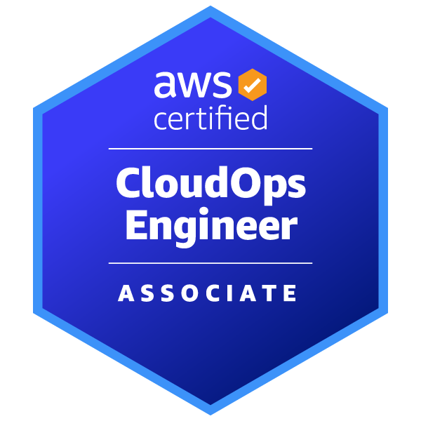

# CedsCode

**`DevOps` `SRE` `Platform Engineering`**

<h3>I keep production AWS environments running, and I build side projects the way I'd want production to be built: defined in code, monitored from day one, with a safe way to roll back.</h3>

Contact: [LinkedIn](https://linkedin.com/in/paclicedric) ☑️ · [Portfolio](https://cedscode.vercel.app/)

## Tech Stack

### Specialized:

  &nbsp;
  &nbsp;
  &nbsp;
  &nbsp;
  &nbsp;
  

### Others:

  &nbsp;
  &nbsp;
  

## Certifications

  &nbsp;
  

## Contribution Activity

<picture>
  <source media="(prefers-color-scheme: dark)" srcset="https://raw.githubusercontent.com/CedsCode/CedsCode/output/galaga-contribution-graph-dark.svg" />
  <source media="(prefers-color-scheme: light)" srcset="https://raw.githubusercontent.com/CedsCode/CedsCode/output/galaga-contribution-graph.svg" />
  
</picture>

---

### 💬 Let's Connect!

*Open to collaborations in DevOps, SRE and platform engineering*

